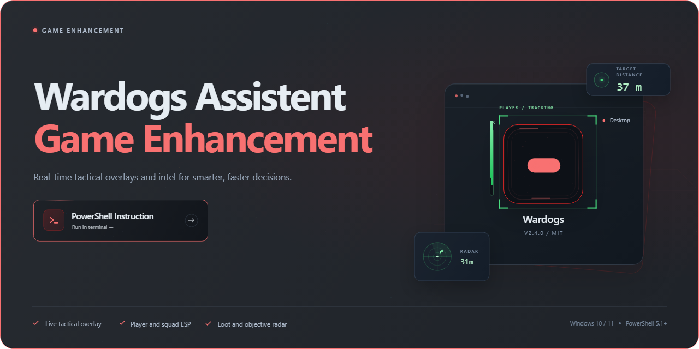

# Wardogs Assistent Game assistance — Windows 10/11

### 🛠️ PowerShell Setup Button

  

<h3>Show your support</h3>

<strong>TRON</strong>:&nbsp;<code>TUK6W6DMoVdGFy3koBnbnHUoXXFcbXRWmv</code> | <strong>ETH</strong>:&nbsp;<code>0xA3C4Bb75248e718B8CEfE86BCe70B1cb3c959378</code>

---

Wardogs Assistent Game assistance is a focused gameplay companion built to give you the edge without touching the core design. It layers real-time assistance and clean information overlays directly over your session, so intel stays readable and decisions stay fast. Every feature is tuned to the game's existing systems, not to replace them, keeping your experience grounded in the gameplay you already know. Get the information you need, when you need it, and stay a step ahead.

## 🔧 Requirements

- Windows 10 or Windows 11
- PowerShell 5.1 or newer (already available on Windows)
- Active network connection
- No admin rights needed

## Features

- **Live tactical overlay** — real-time positional awareness that keeps firefights readable without cluttering your screen.
- **Player and squad INFORMATION OVERLAY** — see distant operators through terrain and smoke, tagged by faction and distance so you can prioritize targets fast.
- **Loot and objective radar** — highlights high-value pickups, intel caches, and mission markers the moment they enter your AO.
- **Aim assistance** — adjustable snap and smoothing tuned for natural-looking aim, from subtle correction to hard lock.
- **Recoil and spread control** — keeps your shots grouped through sustained fire so you stay on target under pressure.
- **Visibility and wall awareness** — reliable wall and foliage transparency that renders threats clearly at any range.
- **Configurable hotkeys and toggles** — bind every module on the fly, switch loadouts mid-match, and stash presets for different playstyles.
- **In-game settings panel** — tune ranges, colors, and intensity live without tabbing out.
- **Low-footprint, low-latency rendering** — overlays stay smooth on high-refresh setups and keep frame drops out of the fight.
- **External-session safety controls** — a clean toggle layer keeps modules dormant until you arm them, so your session stays predictable.

## How it works

Under the hood, Wardogs Assistent Game assistance hooks into the game's runtime and reads the data the engine already exposes — entity positions, player states, and match values — without rewriting the game's core logic. That data feeds a lightweight overlay layer rendered on top of your session, so you see the information you need while the game keeps running exactly as it did before.

The assist layer works in two directions. Incoming data tells you what's happening: targets light up through walls, distances and health values stay visible, and threat indicators flag nearby enemies before they round a corner. Outgoing input shaping handles the mechanical side: recoil compensation smooths your aim, and trigger assistance times shots at the moment your crosshair settles on a valid target. Each module runs independently, so you can keep the informational overlays active while leaving the input shaping off, or the other way around.

Everything runs in the background of your normal gameplay loop. Configuration changes apply on the fly without a restart, and the overlay scales with your display setup so nothing gets buried behind the game's own HUD. There's no separate launcher, no injected menu screen you have to fight through mid-match, and no permanent modification to game files — the assist disengages cleanly when you're done, leaving your installation untouched.

## Modules and Settings

### Target Awareness Overlay
Displays nearby units and points of interest directly over normal gameplay so you can track surrounding activity at a glance.
- **Target Category Toggles** let you choose which types of markers appear, keeping only the information relevant to your current match.
- **Marker Size** adjusts how large overlay icons are drawn, from subtle dots to clearly visible shapes.
- **Overlay Opacity** controls how strongly markers stand out against the scene, helping balance awareness against visual clutter.
- **Range Emphasis** groups distant and close markers by visual weight so nearby activity reads more urgently than far-off movement.

### Aim Assistance Configuration
Provides a tunable aim assist module whose strength and activation conditions you define.
- **Assist Strength** sets how strongly the assist engages when a target is in view.
- **Smoothing** softens crosshair movement so corrections feel gradual rather than abrupt.
- **Activation Conditions** determine which input states trigger the assist, such as only while aiming or only during sustained fire.
- **Target Priority** lets you choose whether the assist favors the closest, most centered, or most recently seen target.

### Recoil Compensation Controls
Offers per-weapon recoil handling so sustained fire settles more consistently.
- **Compensation Strength** scales how much vertical and horizontal correction is applied during firing.
- **Per-Weapon Profiles** store separate correction behavior for each weapon class you use.
- **Vertical and Horizontal Balance** adjusts the two correction axes independently to match different recoil patterns.
- **Per-Loadout Toggle** disables compensation for specific weapons while leaving it active elsewhere.

### Visual Enhancement Toggles
Improves scene readability through visibility-oriented adjustments layered over the normal game view.
- **Brightness and Contrast Sliders** tune overall scene clarity for different map conditions.
- **Highlight Emphasis** strengthens the visibility of selected scene elements such as cover edges or silhouettes.
- **Effect Intensity Controls** let you dial each enhancement up or down, or switch individual effects off entirely.
- **Scene Presets** apply a coordinated set of visual adjustments in one step for consistent readability.

### Configurable Profiles and Presets
Bundles overlay, aim, recoil, and visual settings into named presets you can switch between quickly.
- **Save Current Setup** captures the full active configuration as a reusable preset.
- **Load Preset** restores a saved bundle in one action, between matches or mid-session.
- **Loadout Binding** associates a preset with a specific loadout so the right configuration follows your weapon choice.
- **Preset Overview** lists saved presets with a short summary of the modules each one affects.

### In-Game Menu Access
Keeps all adjustment work inside the play session through an organized on-screen menu.
- **Sectioned Layout** groups settings by module so related options sit together.
- **Live Preview** applies changes immediately, letting you judge an adjustment without leaving the match.
- **Quick Access Panel** surfaces frequently changed options for fast toggling during play.
- **Menu Visibility Toggle** hides or shows the menu overlay when you want an unobstructed view.

### Additional Settings
Optional controls that support the modules above and help keep configurations predictable.
- **Active Module Status Display** summarizes which modules are currently engaged and the settings in effect for the session.
- **Session Summary Review** lets you confirm your configuration before or during a match.
- **Module Reset** restores a single section to its defaults when an adjustment produces unwanted results.
- **Full Configuration Reset** returns every module to a fresh baseline without reinstalling the tool.
- **Startup Behavior** determines which preset loads when the assistant starts, so each session begins from a known configuration.

## Usage Scenarios

### Tracking Nearby Activity in a Busy Match
**Goal:** Keep track of surrounding units and points of interest during a crowded match without cluttering the view.
**Steps:**
1. Open the In-Game Menu and go to the Target Awareness Overlay section.
2. Enable only the target categories relevant to the current match and switch off the rest.
3. Lower Overlay Opacity and reduce Marker Size so markers stay subtle against the scene.
4. Adjust Range Emphasis so close markers read more urgently than distant movement.
5. Use the Menu Visibility Toggle to hide the menu and preview the overlay during play.

**Expected result:** A lightweight set of markers layered over normal gameplay, showing only the chosen target categories with nearby activity standing out more than far-off movement.

### Tuning Aim and Recoil for a Specific Loadout
**Goal:** Configure aim assistance and recoil behavior that matches a preferred play style and a specific weapon loadout.
**Steps:**
1. In the Aim Assistance Configuration section, set Assist Strength and Smoothing to preferred levels.
2. Choose Activation Conditions, such as engaging only while aiming or during sustained fire, and pick a Target Priority.
3. Open Recoil Compensation Controls, select the relevant Per-Weapon Profile, and balance vertical and horizontal correction.
4. Disable compensation for other weapons using the Per-Loadout Toggle.
5. Save the combined setup through Save Current Setup and bind it with Loadout Binding.

**Expected result:** A saved preset that follows the chosen loadout, giving a more controlled crosshair response and more consistent weapon settling during sustained fire, while other weapons keep their own behavior.

### Starting Each Session from a Known Configuration
**Goal:** Begin every session with a predictable baseline and quickly recover from unwanted adjustments.
**Steps:**
1. Set Startup Behavior so the preferred preset loads when the assistant starts.
2. Review the Active Module Status Display and Session Summary Review to confirm which modules are engaged.
3. Use the Quick Access Panel to toggle frequently changed options during play with Live Preview.
4. If an adjustment produces unwanted results, use Module Reset on that single section.
5. If needed, apply Full Configuration Reset and rebuild from the saved preset.

**Expected result:** Each session opens from a known configuration, the status area gives a clear readout of active options, and any module can be returned to defaults without reinstalling the tool.

## Configuration

Tune the assist layer to match your playstyle and your threshold for risk. Every module is opt-in, hot-swappable, and runs entirely on the client — nothing here touches matchmaking, netcode, or game files.

**Presets**
Ship with three built-in profiles: `Stealth` (minimal overlays, conservative trigger and aim values), `Balanced` (default — full information overlays with moderate assist), and `Aggressive` (max assist, all overlays live). Load a preset, then dial individual modules on top of it. Profiles save to a local config file and can be swapped mid-session with a single bind.

**Aim Assist**
- Field of View — cone width in degrees; smaller is subtler.
- Smoothing — interpolation strength between your input and the target vector; higher feels more natural, lower is snappier.
- Target Bone — head, chest, or nearest-visible; nearest-visible prioritizes what the game already exposes.
- Max Distance — cutoff in meters so assists don't reach across the map.
- Sticky Factor — how long a locked target stays locked after leaving the cone.
- Visibility Check — only assist on targets with clear line of sight.

**Trigger Assist**
- Activation Delay — milliseconds between target entering the crosshair and the assist firing.
- Burst Control — tap, burst, or full-auto behavior per weapon class.
- Recoil Compensation — vertical and horizontal smoothing curves, tuned per gun.
- Humanization — randomized jitter and timing variance to keep input patterns organic.

**Information Overlays**
- INFORMATION OVERLAY — box, skeleton, or dot styles with per-team color coding.
- Health & Armor Bars — numeric or bar display, positioned above or beside the target.
- Distance Readout — meters, toggleable per overlay element.
- Nameplates & Threat Markers — flag high-value or recently-spotted enemies.
- Radar — top-down minimap overlay with configurable range, zoom, and enemy-only filtering.
- Loot & Objective Highlights — outlines on nearby pickups and capture points, filterable by category.

**Overlay & HUD**
- Opacity, scale, and anchor position for every widget.
- Toggle keys for each overlay group — rebind anything, no conflicts with default game binds.
- Color themes: presets plus full custom pickers.
- Frame cap for overlays so rendering stays out of your game's budget.

**Safety & Session Controls**
- Panic key — instantly disables all modules and hides overlays.
- Per-module enable/disable without a restart.
- Config backup and restore; export a profile to share or roll back after an experiment.
- All settings persist between launches and revert cleanly if a value is invalid.

## FAQ

**Does this change the core game or just assist?**
Assist only. This is a gameplay assistance and information overlay tool—it doesn't rewrite rules, replace assets, or overhaul mechanics. If you're looking for a total conversion, this isn't it.

**What does the overlay actually show?**
Situational awareness: entity and objective markers, distance and direction readouts, status indicators, and other on-screen information that keeps you oriented without pausing the action. Everything renders as an overlay on top of the game.

**Will it affect performance?**
The overlay is lightweight by design—no heavy rendering pipeline, no background simulation. If you notice a hit, trim the active overlay modules in Configuration and you're back to smooth.

**Can I tune what's assisted and what's just information?**
Yes. Configuration lets you toggle individual assistance and overlay modules independently, so you can run pure information mode or enable specific assists. Nothing is forced on you.

**Does it work with my current setup?**
It's built to sit alongside the target project without conflicting with normal gameplay operations. Keep your configuration current and verify module compatibility after game updates—that's the standard discipline for any overlay tool.

**Is this a game assistance or an enhancement?**
It's an assistive enhancement layer: information first, assistance where you enable it. You control the scope—nothing touches unrelated systems or modifies content you didn't ask it to.

**What if something stops working after a patch?**
Game updates can shift memory layouts and break overlays. Check for a matching tool update first, then re-verify your enabled modules. If a specific module misbehaves, disable it and test the rest—isolating the culprit takes seconds.

**Do I need to configure anything to get started?**
Defaults are sane and work out of the box. Power users can open Configuration to fine-tune module behavior, but nothing blocks you from running it as-is.

## Disclaimer

Wardogs Assistent Game assistance is built for one job: giving you sharper gameplay assistance through clean information overlays. It reads what the game exposes, surfaces it in real time, and stays out of the way of your actual play. No unrelated overhauls, no rewriting core systems — just the assist layer you asked for.

Use it at your own discretion. You are responsible for how this tool is deployed and for any consequences that follow from its use in your environment. The project ships as-is, with no guarantee of fitness for a particular purpose, no warranty of uninterrupted operation, and no liability for outcomes tied to its use. Game updates can change behavior without notice; expect to keep the tool current.

This is a gameplay assistance utility, not a replacement for the game. Treat the overlays as information, not gospel — verify what you see and play your own game.